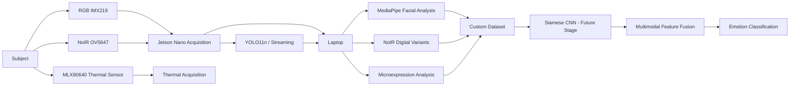
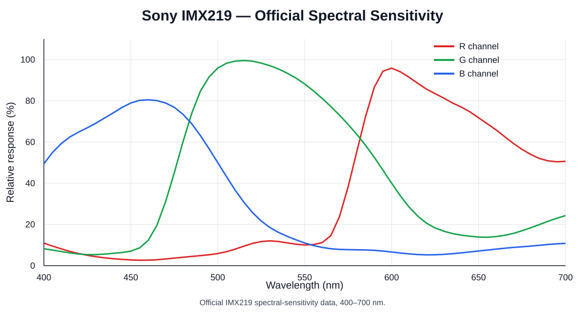
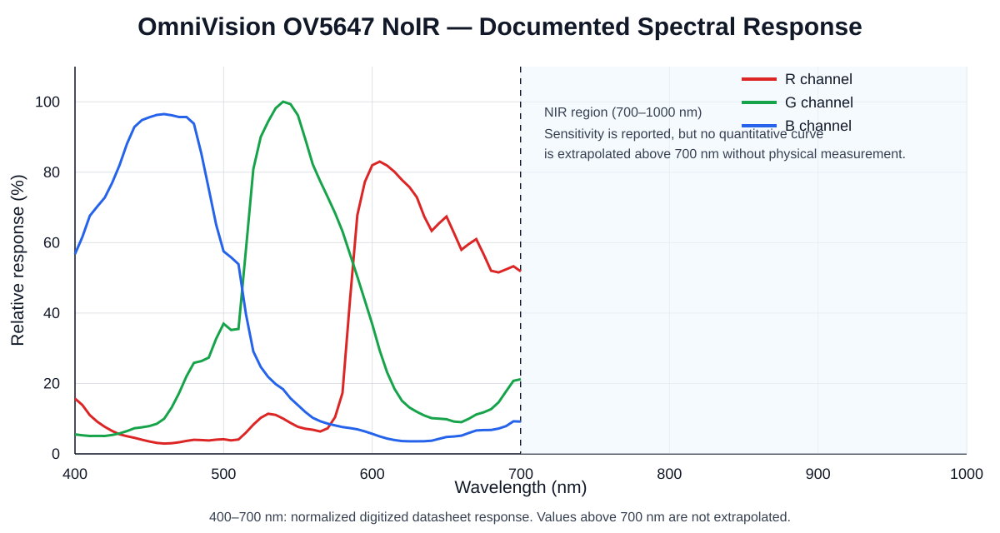
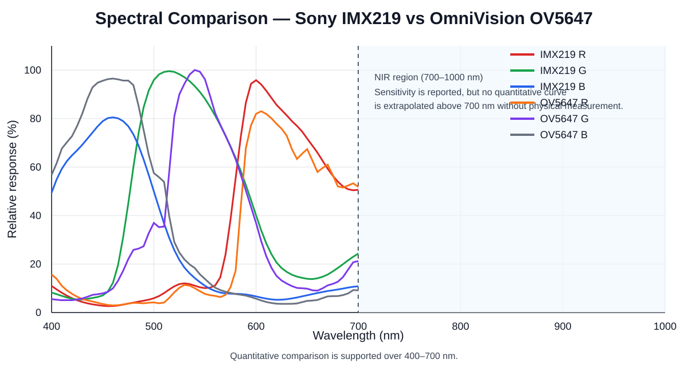
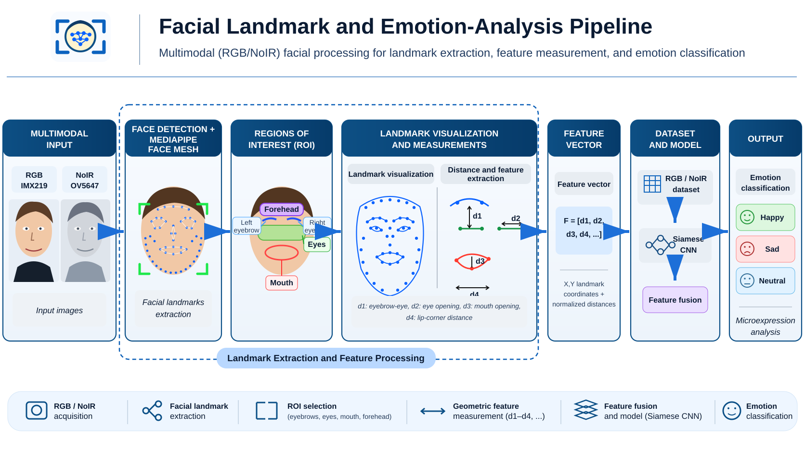
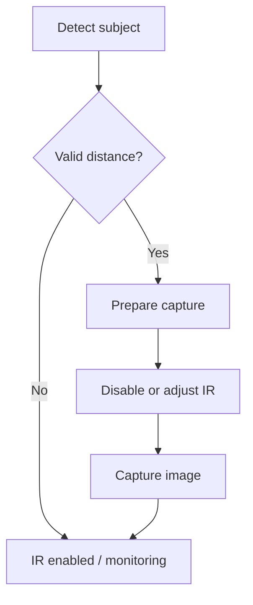
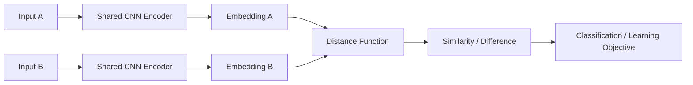

# RGB, NoIR and Thermal Video Classification Using Siamese Convolutional Networks

## Project Description

This project aims to develop a multimodal artificial intelligence system for human emotion analysis using **RGB video, NoIR video and thermal information**. The experimental platform integrates a **Sony IMX219 RGB camera**, an **OmniVision OV5647 NoIR camera**, a **MLX90640 thermal sensor**, and an **NVIDIA Jetson Nano** for acquisition and edge processing.

The purpose of the system is to exploit complementary information from different sensing modalities. RGB imaging provides conventional facial appearance, color and texture information; NoIR imaging extends the visual analysis toward the near-infrared region; and thermal imaging is intended to provide facial temperature-distribution information. The current implementation focuses on camera acquisition, facial detection, landmarks, microexpression-related features, YOLO11n object detection, dataset generation and quality control. A Siamese convolutional architecture is planned for the learning and comparison of multimodal facial representations.

> **Current development status:** RGB and NoIR acquisition, YOLO11n, MediaPipe facial analysis, custom dataset generation, NoIR processing, and dataset quality control are implemented. MLX90640 integration and Siamese-network training remain future stages.

---

## Objectives

### General Objective

Develop a multimodal system capable of acquiring and processing RGB, NoIR and thermal information to support human emotion analysis using Siamese convolutional neural networks.

### Specific Objectives

- Implement RGB and NoIR video acquisition on NVIDIA Jetson Nano.
- Integrate the MLX90640 thermal sensor.
- Compare the spectral behavior of the IMX219 RGB and OV5647 NoIR cameras.
- Detect faces and extract facial landmarks.
- Analyze geometric facial features and microexpression candidates.
- Build a structured custom dataset containing images and metadata.
- Evaluate YOLO11n object detection on the Jetson Nano.
- Store RGB, NoIR and digitally processed NoIR variants.
- Apply dataset quality control before model training.
- Design a multimodal Siamese architecture for later classification stages.

---

## Hardware

| Component | Model | Role |
|---|---|---|
| Embedded computer | NVIDIA Jetson Nano | Main acquisition and edge-processing platform |
| RGB camera | Sony IMX219 | Visible-spectrum facial acquisition |
| NoIR camera | OmniVision OV5647 | Visible + near-infrared acquisition |
| Thermal sensor | MLX90640 | Thermal facial information |
| Distance sensor | TFmini | Capture-distance control |
| IR illumination module | External IR illuminator | Support for NoIR acquisition |
| Laptop | Windows PC | Visualization, MediaPipe processing and dataset storage |

---

## System Architecture



---

## Cameras

### RGB Camera — Sony IMX219

The Sony IMX219 is used as the main visible-spectrum camera. It provides facial appearance information such as:

- Skin texture and visible color.
- Eye and eyebrow geometry.
- Mouth and lip motion.
- Facial contour.
- Glasses.
- Beard.
- Hair covering the forehead.
- Visual information used by face and object-detection algorithms.

### NoIR Camera — OmniVision OV5647

The OV5647 NoIR camera differs from a conventional RGB camera because the module does not use the same IR-cut filtering found in standard visible-light camera modules. Therefore, it can record visible light while retaining sensitivity in the near-infrared region.

The accepted NoIR processing reference for this project is:

```text
NOIR FILTER LAB v8.1
File: code/tools/noir_interface_v8_1.py
```

The six digital NoIR representations are:

1. ORIGINAL NOIR
2. RED BANDPASS VIRTUAL
3. IR-CUT / RGB VIRTUAL
4. BLUE BANDPASS VIRTUAL
5. IR BANDPASS VIRTUAL
6. UV BANDPASS VIRTUAL

> These are **digital image transformations**, not six independent physical spectral filters. The original NoIR image is always retained in the dataset.

---

## Spectral Response

The following plots use the most defensible spectral information available for the two sensors. The IMX219 plot is based on published spectral-sensitivity values over the visible range. The OV5647 plot uses digitized, normalized datasheet information over 400–700 nm. The NIR region above 700 nm is identified without inventing a quantitative response curve where the cited source does not provide one.

### Sony IMX219



### OmniVision OV5647 NoIR



### IMX219 vs OV5647



### Interpretation

- **IMX219 RGB:** primarily used for conventional visible-light facial analysis.
- **OV5647 NoIR:** provides visible information and additional sensitivity toward the NIR region.
- **MLX90640:** belongs to a different thermal-infrared sensing domain and is treated as a separate modality.

---

## Facial Landmark and Feature-Extraction Pipeline

The complete facial-analysis pipeline used in this project is shown below. This figure mirrors the full processing diagram used in the Spanish project documentation and separates acquisition, landmark extraction, regions of interest, geometric measurements, feature construction, dataset/model processing and the future classification output.



### Stage 1 — Multimodal Input

Two synchronized visual modalities are considered:

- **RGB IMX219:** conventional visible-light facial information.
- **NoIR OV5647:** visible + near-infrared-sensitive facial information.

Both channels are preserved because the objective is not to replace one modality with the other, but to compare and later combine complementary information.

### Stage 2 — Face Detection and MediaPipe Face Mesh

The system detects the face and applies MediaPipe facial analysis to obtain a dense facial representation. The dense facial mesh is used as the source for selecting stable points and facial regions.

The project stores a reduced structured representation of **68 landmarks** for geometric analysis and dataset organization. Where available, the current laptop pipeline also stores **52 facial blendshapes**.

### Stage 3 — Regions of Interest (ROI)

The facial mesh is separated into regions that are especially relevant for facial expression and microexpression analysis:

- Forehead.
- Left eyebrow.
- Right eyebrow.
- Left eye.
- Right eye.
- Mouth.
- Lip corners.

These regions allow the system to measure localized facial motion instead of relying only on the full-face image.

### Stage 4 — Landmark Visualization and Measurements

Selected landmark coordinates are converted into measurable geometric features. A facial point is represented by:

$$
p_i=(x_i,y_i)
$$

The Euclidean distance between two landmarks is:

$$
d(p_a,p_b)=\sqrt{(x_a-x_b)^2+(y_a-y_b)^2}
$$

The diagram summarizes four representative measurements:

| Feature | Example meaning |
|---|---|
| $d_1$ | Eyebrow-to-eye distance |
| $d_2$ | Eye opening / horizontal or normalized eye feature |
| $d_3$ | Mouth opening |
| $d_4$ | Distance between lip corners |

The actual dataset can include additional normalized geometric features derived from facial landmarks.

Examples used during project development include eye aspect ratio, eyebrow height, inner/outer mouth opening and relative smile width.

### Stage 5 — Feature Vector

After normalization, the extracted values are grouped into a feature vector:

$$
\mathbf{F}=[d_1,d_2,d_3,d_4,\ldots]
$$

The feature representation may include:

- Absolute landmark coordinates.
- Normalized landmark coordinates.
- Distances between selected landmarks.
- Eye-opening measurements.
- Mouth-opening measurements.
- Eyebrow displacement.
- Blendshape scores.
- Temporal microexpression-related features.
- Modality identifier and capture metadata.

### Stage 6 — Dataset and Siamese Model

The extracted features and associated images are stored in the multimodal dataset. RGB and NoIR samples from the same acquisition event are linked using shared identifiers.

The future learning stage uses a **Siamese convolutional neural network**, where related inputs are projected into a shared embedding space. Multimodal feature fusion is then intended to combine visual, NoIR, geometric and later thermal information.

### Stage 7 — Emotion Classification

The final output shown in the diagram — for example **Happy, Sad and Neutral** — represents the planned classification stage after a validated training protocol is completed.

At the current stage, the project should be interpreted as an **acquisition, preprocessing, facial-feature extraction and dataset-generation platform**. The repository does not claim that a final validated emotion classifier has already been trained.

### Microexpression Analysis

Microexpression-related processing focuses on small temporal changes in the selected ROI. The system records short-term variations in eyebrows, eyes, mouth, lip corners and other facial features so they can later be evaluated as part of the emotion-learning stage.

---

## Jetson Nano Acquisition

The RGB and NoIR cameras are connected through the Jetson Nano CSI interfaces.

Configurations tested during development include:

- 1280 × 720 @ 30 FPS.
- 1920 × 1080 @ 30 FPS.
- NV12.
- GStreamer / NVIDIA Argus.
- Independent `sensor-id` selection.
- Exposure compensation.
- Gain control.
- NoIR-specific exposure settings.

The final logical camera assignment used by the project is:

| sensor-id | Sensor | Role |
|---:|---|---|
| 0 | IMX219 | RGB |
| 1 | OV5647 | NoIR |

The project also includes a custom OV5647 driver / Device Tree configuration for JetPack 4.6.1 / L4T R32.7.1. See:

```text
drivers/ov5647_noir/
```

---

## Face Detection and Landmarks

Several facial-landmark approaches were evaluated during development.

### 68-Point Landmark Model

An initial 68-point model was used to represent:

- Jawline.
- Left eyebrow.
- Right eyebrow.
- Nose.
- Left eye.
- Right eye.
- Outer mouth.
- Inner mouth.

This approach was useful for geometric measurements but showed stability limitations in some NoIR and motion conditions.

### MediaPipe

MediaPipe was later integrated because it provided more stable facial tracking for the laptop-side processing pipeline.

The current dataset pipeline uses facial information derived from MediaPipe and maintains a reduced **68-landmark representation** for structured storage and geometric analysis. The implementation also stores **52 facial blendshapes** where available.

---

## Microexpression Analysis

The project evolved from general facial-expression capture toward the analysis of smaller facial variations and microexpression candidates.

Regions of interest include:

- Left eyebrow.
- Right eyebrow.
- Eyes.
- Mouth.
- Lip corners.
- Forehead.

Temporal variations from these regions are stored for later analysis. At the current stage, the system is primarily an **acquisition and feature-extraction platform**; it does not yet claim a final trained emotion classifier.

---

## YOLO11n Object Detection

YOLO11n is executed on the Jetson Nano through a local CUDA/Docker inference service.

Main files:

```text
code/main/jetson/JETSON_V11_10_ESTABLE.py
code/main/jetson/yolo11_v9_server_docker.py
```

The local YOLO service uses:

```text
Host: 127.0.0.1
Port: 5070
Protocol header: FRM2
Model: yolo11n.pt
```

Early tests on Jetson Nano produced approximately **5 FPS** under the tested configuration. Optimization is constrained by compute resources and thermal considerations.

---

## Jetson–Laptop Communication

The current distributed architecture separates acquisition from higher-level dataset processing.

```text
RGB / NoIR Cameras
        ↓
   Jetson Nano
        ↓
 YOLO11n / TFmini
        ↓
 TCP Communication
        ↓
      Laptop
        ↓
MediaPipe + NoIR processing + Dataset
```

Current network ports:

| Port | Function |
|---:|---|
| 5050 | Compatibility / PING-PONG service |
| 5051 | Live preview and telemetry — FPR8 |
| 5052 | Original RGB + NoIR stream — FORG |
| 5070 | Local Jetson-to-YOLO service — FRM2 |

---

## Custom Dataset

The current dataset infrastructure is based on **V16.19** and includes structured Excel output, image files, landmarks, object detections, NoIR variants, microexpression information and quality-control metrics.

For each capture event, the system can store up to **8 image channels**:

1. RGB
2. NOIR
3. NOIR_ORIGINAL
4. NOIR_RED
5. NOIR_IRCUT
6. NOIR_BLUE
7. NOIR_IR
8. NOIR_UV

### Dataset Sheets

| Sheet | Information |
|---|---|
| `CAPTURAS` | Capture metadata, paths, quality, group IDs and valid-channel information |
| `PERSONAS` | Person ID, YOLO association, face metrics and landmark source |
| `LANDMARKS` | 68 landmarks, absolute/normalized coordinates and outlier information |
| `OBJETOS` | YOLO detections |
| `FILTROS_NOIR` | Results for each NoIR digital variant |
| `MICROEXPRESIONES` | Temporal events and microexpression-related series |
| `CALIDAD_DATASET` | Quality metrics and training recommendation |

### Dataset Identifiers

- `group_id`: groups all derivatives from the same capture event.
- `subject_group`: identifies the person (`P01`, `P02`, etc.).

These fields are intended to prevent samples derived from the same capture or subject from leaking across training, validation and test subsets.

---

## Landmark Representation

Each valid face is represented by 68 points:

$$
L_i=(x_i,y_i), \qquad i=1,2,\ldots,68
$$

The facial matrix is:

$$
\mathbf{L}\in\mathbb{R}^{68\times2}
$$

Basic face-box normalization:

$$
x_i^{norm}=\frac{x_i-x_{face}}{w_{face}}
$$

$$
y_i^{norm}=\frac{y_i-y_{face}}{h_{face}}
$$

The pipeline uses several recovery stages when facial landmarks are difficult to obtain:

```text
LIVE
  ↓
FULL FRAME
  ↓
YOLO ROI
```

When a ROI is used, the resulting coordinates are remapped to the original frame coordinate system.

---

## Dataset Quality Control

V16.19 adds historical landmark quality control based on the interquartile range (IQR).

$$
IQR=Q_3-Q_1
$$

$$
L_{lower}=Q_1-1.5\,IQR
$$

$$
L_{upper}=Q_3+1.5\,IQR
$$

A measurement is marked as an outlier when:

$$
x<L_{lower}\quad \text{or}\quad x>L_{upper}
$$

Outlier percentage:

$$
P_{outlier}=\frac{N_{outlier}}{N_{total}}\times100
$$

Historical comparisons are kept separated by modality and landmark index. For example, RGB landmark 33 is compared only against previous RGB landmark-33 values.

---

## Capture Distance

The current capture logic uses a TFmini distance sensor and a working facial acquisition interval of approximately:

```text
30 cm – 60 cm
```

A target distance near the middle of the interval is used to improve consistency between samples.

---

## Multiple-Face Capture

The system has also been developed to handle multiple detected faces. The interface can:

1. Detect multiple subjects.
2. Assign person identifiers such as `P01`, `P02`, `P03`.
3. Display detected subjects.
4. Place subjects in a capture queue.
5. Store multiple face crops and metadata.
6. Associate each person consistently with the same capture event.

---

## IR Illumination Control

The Jetson implementation contains logic for IR-illumination control associated with capture distance.



> A Jetson GPIO must not directly power the IR illuminator. The GPIO should control an appropriate transistor, MOSFET, relay or enable input.

---

## Siamese Convolutional Network — Proposed Stage

The final learning stage is designed around Siamese convolutional networks.



For two inputs:

$$
e_A=f_\theta(x_A), \qquad e_B=f_\theta(x_B)
$$

Euclidean distance:

$$
D(A,B)=\sqrt{\sum_{i=1}^{n}(e_{A,i}-e_{B,i})^2}
$$

A contrastive-loss formulation can be expressed as:

$$
L=yD^2+(1-y)\max(0,m-D)^2
$$

The goal is to learn a representation space in which related multimodal patterns are closer and unrelated patterns are more separated.

---

## Development Work Completed

The project has progressed through several hardware and software integration stages:

1. **Jetson camera bring-up**
   - IMX219 RGB acquisition through CSI / NVIDIA Argus.
   - OV5647 NoIR integration through a custom kernel driver and Device Tree configuration.
   - Dual-camera logical assignment using `sensor-id=0` and `sensor-id=1`.

2. **NoIR acquisition and image processing**
   - Exposure and gain tuning.
   - External IR illumination tests.
   - Six NoIR digital representations.
   - Selection of **NOIR FILTER LAB v8.1** as the reference processing interface.

3. **Facial-analysis experiments**
   - Initial 68-point landmark approach.
   - Transition toward MediaPipe for more stable facial tracking.
   - Region-of-interest analysis for eyebrows, eyes, mouth and forehead.
   - Storage of reduced 68-landmark geometry and facial blendshapes.

4. **YOLO11n integration**
   - Object and person detection on Jetson Nano.
   - Local CUDA/Docker inference service.
   - RGB and NoIR processing support.
   - Performance measurements under Jetson Nano resource constraints.

5. **Jetson–Laptop distributed architecture**
   - Lightweight acquisition on Jetson.
   - Preview and original-frame streaming over TCP.
   - Laptop-side MediaPipe and dataset processing.
   - Separate communication channels for preview, original frames and YOLO inference.

6. **Custom dataset generation**
   - Person identifiers such as `P01`, `P02`, `P03`.
   - Multi-face capture workflow.
   - Image and metadata storage.
   - Excel-based structured dataset.
   - RGB, NoIR and processed NoIR channels.
   - Capture-distance information.
   - Manual attributes such as glasses, beard and hair over the forehead where required by the acquisition protocol.

7. **Dataset quality control**
   - Channel-validity checks.
   - Landmark normalization.
   - Historical IQR-based outlier detection.
   - `group_id` and `subject_group` fields to reduce train/validation/test leakage.

8. **Driver and reproducibility documentation**
   - OV5647 kernel-module installation notes.
   - Mixed IMX219 + OV5647 Device Tree configuration.
   - GStreamer validation commands.
   - Documented JetPack / L4T / kernel environment.

---

## Software and Technologies

The project uses or has evaluated:

- Python.
- OpenCV.
- NVIDIA GStreamer / Argus.
- MediaPipe.
- Ultralytics YOLO11n.
- NumPy.
- OpenPyXL.
- Pillow.
- TCP sockets.
- UART / serial communication.
- Jetson.GPIO.
- CUDA / Docker for YOLO inference.
- I²C for the planned MLX90640 thermal integration.
- Convolutional neural networks.
- Siamese neural networks.
- Computer vision and digital image processing.

---

## Current Project Status

| Module | Status |
|---|---|
| RGB IMX219 acquisition | ✅ Functional |
| NoIR OV5647 acquisition | ✅ Functional |
| Dual CSI cameras | ✅ Functional |
| Custom OV5647 Jetson driver / DT | ✅ Implemented in project environment |
| NOIR FILTER LAB v8.1 | ✅ Reference version |
| YOLO11n | ✅ Tested |
| MediaPipe facial analysis | ✅ Implemented |
| 68-landmark structured representation | ✅ Implemented |
| 52 blendshapes | ✅ Implemented where available |
| Microexpression candidate analysis | ✅ Implemented in acquisition pipeline |
| Custom dataset V16.19 | ✅ Stable infrastructure |
| IQR quality control | ✅ Implemented |
| Multi-face dataset workflow | 🟡 Under continued development |
| IR automatic control | 🟡 Under testing |
| MLX90640 integration | 🟡 Pending / future stage |
| Siamese CNN training | ⏳ Future stage |
| Final multimodal fusion | ⏳ Future stage |
| Final emotion classifier | ⏳ Future stage |

---

## Repository Structure

```text
.
├── README.md
├── RUN.md
├── CODE_STATUS.md
├── code/
│   ├── main/
│   │   ├── jetson/
│   │   │   ├── JETSON_V11_10_ESTABLE.py
│   │   │   └── yolo11_v9_server_docker.py
│   │   └── laptop/
│   │       └── V19.py
│   └── tools/
│       └── noir_interface_v8_1.py
├── drivers/
│   └── ov5647_noir/
│       ├── README_DRIVER.md
│       ├── config/
│       ├── install/
│       ├── source/
│       └── tests/
└── docs/
    ├── imx219_spectral_response_scientific.svg
    ├── ov5647_noir_spectral_response_scientific.svg
    ├── imx219_vs_ov5647_spectral_comparison_scientific.svg
    └── facial_landmark_emotion_analysis_pipeline.svg
```

---

## Running the Project

See:

- [RUN.md](RUN.md)
- [CODE_STATUS.md](CODE_STATUS.md)

The validated runtime code was preserved rather than translated internally to avoid changing program behavior.

---

## OV5647 Driver Documentation

The project required a custom OV5647 integration for the Jetson Nano environment used during development.

Driver documentation is stored at:

- [OV5647 NoIR Driver](drivers/ov5647_noir/README_DRIVER.md)
- [Installation Notes](drivers/ov5647_noir/install/INSTALLATION.md)
- [Source Status](drivers/ov5647_noir/source/SOURCE_STATUS.md)

The documented environment is:

```text
NVIDIA Jetson Nano
JetPack 4.6.1
L4T R32.7.1
Kernel 4.9.253-tegra
Architecture: aarch64
```

---

## Future Work

- Complete MLX90640 integration.
- Synchronize RGB, NoIR and thermal acquisition.
- Increase the size and diversity of the multimodal dataset.
- Refine microexpression labels and experimental protocol.
- Improve IR illumination control.
- Train the visual encoder.
- Train the Siamese architecture.
- Integrate RGB, NoIR, thermal, landmark and blendshape features.
- Evaluate accuracy, precision, recall, F1 score and confusion matrices.
- Measure inference latency, FPS and thermal behavior on Jetson Nano.

---

## Scientific Scope

This repository documents an experimental multimodal acquisition and AI-development platform. The current system should not be interpreted as a clinically validated emotion-recognition system. Spectral-response figures are treated as technical reference data, and the NIR response is not extrapolated quantitatively where calibrated measurements are unavailable.

---

## Author

Professional residency project focused on artificial intelligence, computer vision, embedded processing, multimodal sensing and human emotion-analysis research.
